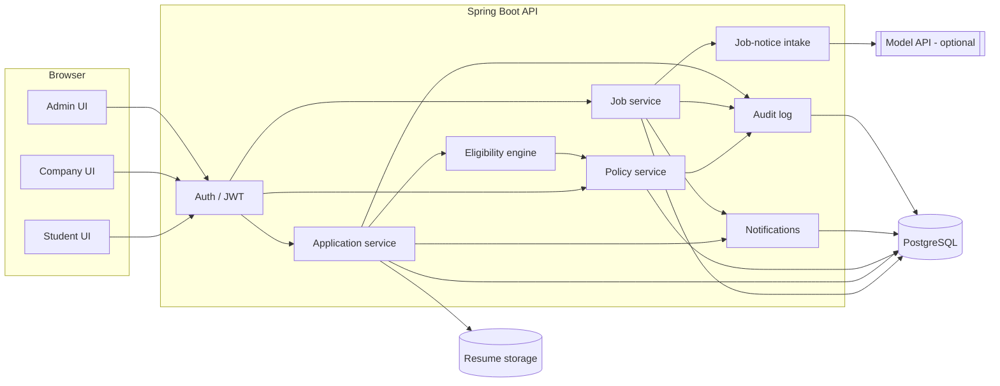
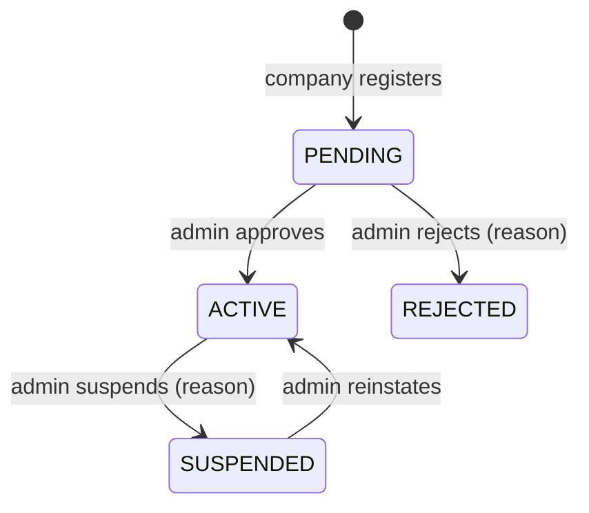
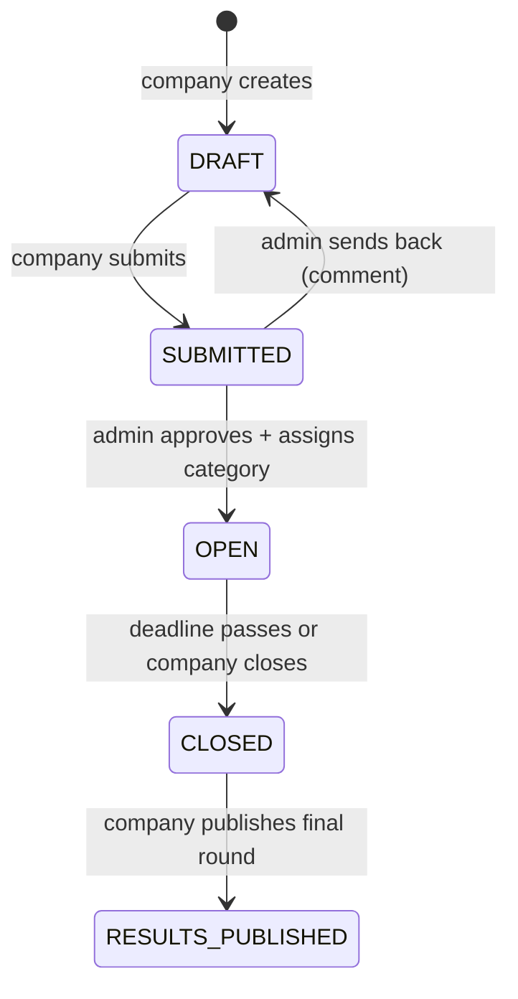
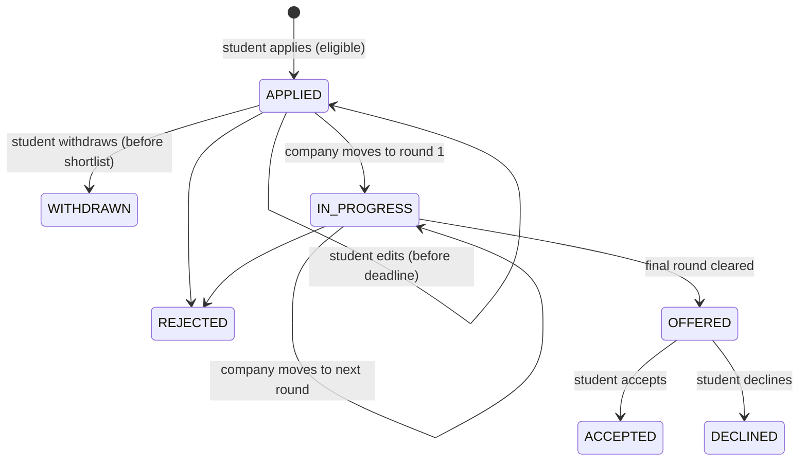
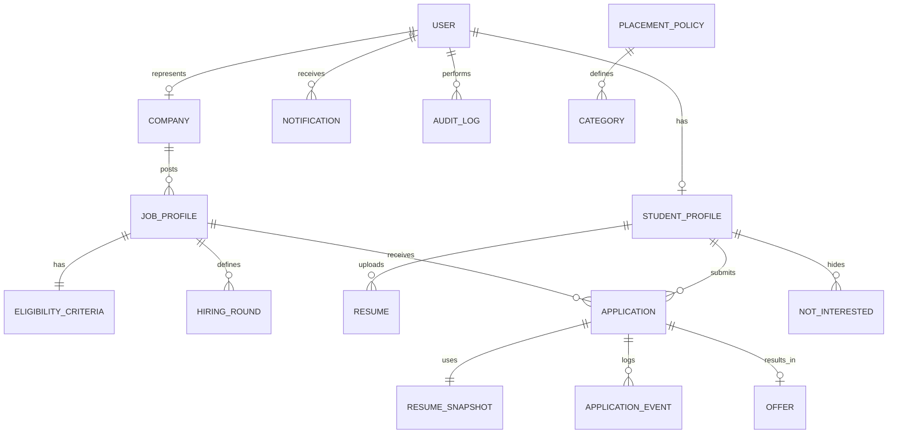

# VELAkadaikuma
> A campus placement portal for three kinds of users: the **placement cell** (admin), **recruiting companies**, and **students**. Every "you can't apply" comes with every reason why.

[](https://github.com/aariyajanams-source/VELAkadaikuma/actions/workflows/ci.yml)


---

## Contents

1. [Why I built this](#why-i-built-this)
2. [The three users](#the-three-users)
3. [Screens](#screens)
4. [How the pieces fit](#how-the-pieces-fit)
5. [Workflows](#workflows)
6. [The eligibility engine](#the-eligibility-engine)
7. [AI job-notice intake](#ai-job-notice-intake)
8. [Permissions](#permissions)
9. [Security](#security)
10. [Data model](#data-model)
11. [API](#api)
12. [Run it](#run-it)
13. [Tests](#tests)
14. [Design decisions](#design-decisions)
15. [Project structure](#project-structure)
16. [Out of scope](#out-of-scope)
17. [Credits and licence](#credits-and-licence)

---

## Why I built this

Placement season runs on four broken loops:

- **Students** find out they're ineligible *after* they click Apply, usually with a one-line error and no reason. The rules sit in a PDF or a WhatsApp forward.
- **Companies** receive resumes as email attachments and spreadsheets, then track who moved to which round by hand.
- **The placement cell** checks every application against the college's rules by hand. "Placed students may only apply to higher-category jobs" is enforced by memory.
- **Nobody** has one place that shows the full state: which companies are approved, which jobs are open, who applied, who moved forward.

Velakadaikuma puts all three sides in one system. Rules live in code, so they're checked the same way every time, and a student always sees *why*.

---

## The three users

| User | Who they are | What they do |
|---|---|---|
| **Admin** | Placement cell staff | Approves or rejects company sign-ups. Sets the college-wide placement policy (categories, offer limits, who may apply where). Verifies student profiles. Approves job postings. Debars students. Overrides with a recorded reason. Sees placement reports. |
| **Company** | Recruiters | Registers and waits for approval. Posts job profiles with eligibility rules, CTC, deadline and hiring rounds. Previews how many students qualify before publishing. Receives applications and resumes. Moves applicants through rounds. Exports results. |
| **Student** | Final-year and pre-final-year students | Builds a profile and uploads a resume. Browses and filters jobs. Sees eligibility on every job before applying. Applies, edits or withdraws before the deadline. Marks jobs "Not interested". Tracks every application's round. |

---

## Screens

The student UI follows the layout most campus placement portals use: a left navigation rail, a filterable job list, and a detail pane.


**Student**

| Page | What's on it |
|---|---|
| **Home** | Open jobs closing soon, application count by status, latest notifications |
| **Job Profiles** | Filters for *Job Sector*, *Position Type* (Full-time / Internship / Intern + PPO), *Status* and *Sort by* (Created at, Deadline, CTC), plus search by title or company. Tabs: **All Jobs** and **Applied Jobs**. Each card shows the company, location, age, and a status chip: *Yet to apply*, *Applied*, *Not eligible*, *Closes in 17 hours*, *Applications closed*. |
| **Job detail pane** | Deadline banner, **Apply** and **Not Interested** buttons, and three tabs: **Job Description**, **Hiring Workflow** (the rounds) and **Eligibility Criteria**. The criteria tab ticks or crosses each rule against *your* profile. The overview shows category, job function, CTC or stipend, and other info. |
| **My Profile** | Academic details (CGPA, branch, batch, 10th/12th %, backlogs), contact, links, verification status |
| **Resume** | Upload or replace a PDF. See which version each application used. |
| **Interviews** | Upcoming rounds with date, time, mode and link |

**Company**

| Page | What's on it |
|---|---|
| **Dashboard** | Approval status, active jobs, new applicants |
| **Job Profiles** | Create, edit, submit, close. The criteria builder shows a live count of eligible students. |
| **Applicants** | Table per job with filters by round. Bulk-move to the next round or reject. Download a single resume or all of them as a ZIP. Export CSV. |

**Admin**

| Page | What's on it |
|---|---|
| **Companies** | Pending / Active / Suspended queues with approve and reject (reason required) |
| **Jobs** | Submitted jobs awaiting approval. Category assignment. |
| **Students** | Verify profiles, debar with reason, view a student's application history |
| **Policy** | Edit the placement policy (see [below](#placement-policy-admin)) |
| **Reports** | Placed / unplaced by branch and category, offers per company |
| **Audit log** | Every admin action, who did it and why |

More screenshots: [`docs/screenshots/`](docs/screenshots/).

---

## How the pieces fit



One Spring Boot app serves the REST API and the static front end (plain HTML, CSS and JavaScript, no framework). PostgreSQL holds everything except resume files, which go to a storage directory and are served only through an authorised endpoint.

---

## Workflows

### 1. Company onboarding



A company in `PENDING` can log in and fill in its profile, but it can't post jobs. The rejection or suspension reason is shown to the company.

### 2. Job profile



- If the policy turns off `requireAdminApprovalForJobs`, submitting goes straight to `OPEN`.
- Once a job is `OPEN`, its eligibility criteria are frozen. Changing the rules after students have applied would be unfair, so the company has to close the job and post a new one.
- Each job defines its own **hiring workflow**: an ordered list of rounds such as *Resume shortlist → Online test → Technical interview → HR interview*. Each round has a type (`SHORTLIST`, `TEST`, `INTERVIEW`, `GROUP_DISCUSSION`, `OTHER`) and an optional date, mode and link.

### 3. Application



- **Edit:** before the deadline a student can swap the resume or change answers to company questions. After the deadline the application is locked.
- **Resume snapshot:** applying copies the current resume file. If the student uploads a new resume next week, the company still sees the one they applied with.
- **Accepting an offer** updates the student's placement status and category. The policy then decides what they can still apply to.
- Every move is stored as an `ApplicationEvent` (from, to, round, by whom, when), so the student's timeline and the company's history come from the same record.

### 4. Student

1. Register with a college email. Fill in the academic profile.
2. Admin verifies the profile. Verified fields are locked; changing them needs re-verification, so CGPA can't be quietly edited.
3. Upload a resume (PDF, max 5 MB).
4. Browse jobs. Each card already shows *Eligible* or *Not eligible*.
5. Apply. Edit or withdraw until the deadline.
6. Follow progress under **Applied Jobs** and **Interviews**. A notification arrives on every round change.

### Notifications

In-app notifications (the bell, with an unread count) for: company approved or rejected, job approved or sent back, new job you're eligible for, deadline in 24 hours, round changed, offer received.

---

## The eligibility engine

When a student opens a job or clicks Apply, the engine checks **every** rule and returns **every** failure, not just the first. A student who fails three rules learns about all three at once.

It combines two layers:

| Layer | Set by | Applies to |
|---|---|---|
| **Placement policy** | Admin | Every job and every student |
| **Job criteria** | Company | One job |

### Placement policy (admin)

```json
{
  "categories": [
    { "name": "Category 1", "minCtcLpa": 12 },
    { "name": "Category 2", "minCtcLpa": 6 },
    { "name": "Category 3", "minCtcLpa": 0 }
  ],
  "placedStudentMayApplyTo": "HIGHER_CATEGORY_ONLY",
  "maxAcceptedOffers": 1,
  "internshipsCountAsPlacement": false,
  "requireVerifiedProfile": true,
  "requireAdminApprovalForJobs": true,
  "maxActiveApplications": null
}
```

The category comes from the job's CTC. The admin can override it when approving the job. Internship stipends are mapped to a category with their own thresholds.

### Job criteria (company)

```json
{
  "minCgpa": 7.0,
  "branches": ["CSE", "ECE"],
  "batches": [2027],
  "maxActiveBacklogs": 0,
  "min10thPercent": 60,
  "min12thPercent": 60
}
```

### Rules checked

| Code | Comes from | Fails when |
|---|---|---|
| `JOB_NOT_OPEN` | Job | The job isn't `OPEN` |
| `DEADLINE_PASSED` | Job | Now is after the deadline (server time) |
| `ALREADY_APPLIED` | Job | An active application exists |
| `PROFILE_NOT_VERIFIED` | Policy | The profile isn't verified |
| `RESUME_MISSING` | Policy | No resume uploaded |
| `DEBARRED` | Admin | The student is debarred |
| `CATEGORY_LOCKED` | Policy | Placed, and the job's category isn't higher |
| `OFFER_LIMIT_REACHED` | Policy | Accepted offers ≥ `maxAcceptedOffers` |
| `APPLICATION_LIMIT_REACHED` | Policy | Active applications ≥ `maxActiveApplications` |
| `CGPA_BELOW_MIN` | Criteria | CGPA < `minCgpa` |
| `BRANCH_NOT_ALLOWED` | Criteria | Branch not in `branches` |
| `BATCH_NOT_ALLOWED` | Criteria | Batch not in `batches` |
| `ACTIVE_BACKLOGS` | Criteria | Backlogs > `maxActiveBacklogs` |
| `TENTH_BELOW_MIN` / `TWELFTH_BELOW_MIN` | Criteria | Below the minimum % |

### What the student gets back

`POST /api/jobs/42/apply` → **422 Unprocessable Entity**

```json
{
  "message": "You are not eligible for this job.",
  "reasons": [
    { "code": "CGPA_BELOW_MIN",    "detail": "Minimum CGPA is 7.0; yours is 6.8." },
    { "code": "BRANCH_NOT_ALLOWED", "detail": "Open to CSE, ECE; your branch is MECH." }
  ]
}
```

The same check runs without applying (`GET /api/jobs/{id}` includes an `eligibility` block), so the *Eligibility Criteria* tab can tick and cross each rule before the student clicks anything.

### Eligibility preview for companies

While drafting criteria, a company sees how many verified students currently qualify ("142 students eligible; 38 excluded by CGPA, 21 by branch"). It sees counts only, never names, so a company can't browse the student database before it's approved and posting.

### How it's built

Each rule is a small class implementing one interface:

```java
public interface EligibilityRule {
    Optional<Reason> check(StudentProfile student, JobProfile job, PlacementPolicy policy, ApplicationStats stats);
}
```

The engine runs all registered rules and collects the failures. Adding a rule means adding one class and one test; nothing else changes.

---

## AI job-notice intake

Companies often already have the job description as a PDF. Instead of retyping it:

1. The company (or admin) uploads the PDF on the *New job* page.
2. Text is pulled out with Apache PDFBox.
3. A model fills a fixed schema: title, position type, locations, CTC or stipend, deadline, branches, batches, minimum CGPA, rounds, description.
4. **Each field is checked before it reaches the form:**
   - **Grounded:** does the value (or its number) actually appear in the PDF text?
   - **Valid:** does it parse? Is the deadline in the future? Do branch names map to the college's branch list? Is CTC a positive number?
   - **Consistent:** for example, an internship with a per-annum CTC gets flagged.
5. Fields that pass are pre-filled. Fields that fail are left **empty and highlighted** with the reason ("deadline not found in document").
6. The company reviews and submits as usual. **Nothing is ever published straight from the model.** The job still goes through `DRAFT → SUBMITTED → OPEN`, and admin approval still applies.

Behind an interface, so the provider can be swapped and tests use a fake:

```java
public interface JobNoticeExtractor {
    ExtractionResult extract(String documentText);
}
```

Turned off by default (`INTAKE_ENABLED=false`). With it off, or with no API key, the page shows the normal manual form. Uploaded PDFs are deleted after extraction.

---

## Permissions

| Action | Student | Company | Admin |
|---|:-:|:-:|:-:|
| See open jobs | ✅ | own only | ✅ |
| Apply / edit / withdraw | own | ❌ | ❌ |
| Create / edit job | ❌ | own, if `ACTIVE` | ✅ |
| Approve job / assign category | ❌ | ❌ | ✅ |
| See applicants | ❌ | own jobs only | ✅ |
| Download a resume | own | applicants to own jobs | ✅ |
| Move applicant to a round | ❌ | own jobs only | ✅ |
| Approve / suspend company | ❌ | ❌ | ✅ |
| Verify / debar student | ❌ | ❌ | ✅ |
| Edit placement policy | ❌ | ❌ | ✅ |
| See audit log | ❌ | ❌ | ✅ |

Every row is covered by an automated test that calls the endpoint as each role and checks the status code (see [Tests](#tests)).

---

## Security

- **Passwords** hashed with BCrypt.
- **JWT** access tokens, short-lived, signed with a secret from the environment (never committed). Role is in the token *and* re-checked against the database for admin actions.
- **Two checks on every request:** the role (`@PreAuthorize`) and *ownership* (a company can only touch its own jobs; a student only their own applications). Ownership is checked in the service layer, not just the controller.
- **Resumes aren't public files.** They sit outside the static folder, under random file names, and are streamed only after the permission check. Wrong owner → `404`, not `403`, so IDs can't be probed.
- **Upload checks:** PDF only, verified by the file's first bytes (not the extension), 5 MB limit.
- **No `innerHTML` with user data** in the front end. All user text goes through `textContent`. A test fails the build if `innerHTML` appears in `static/js`.
- **Audit log** for every admin action and every override, with the reason.
- **Rate limit** on login attempts.

---

## Data model



Schema changes go through Flyway migrations (`src/main/resources/db/migration`). Times are stored in UTC and shown in IST.

---

## API

All endpoints are under `/api` and need `Authorization: Bearer <token>` except register and login.

### Auth

| Method | Path | Who |
|---|---|---|
| POST | `/auth/register/student` | anyone |
| POST | `/auth/register/company` | anyone |
| POST | `/auth/login` | anyone |
| GET | `/me` | any logged-in user |

### Student

| Method | Path | Does |
|---|---|---|
| GET | `/jobs?sector=&type=&status=&sort=&q=` | List jobs with filters (eligibility chip included) |
| GET | `/jobs/{id}` | Job detail + full eligibility result |
| POST | `/jobs/{id}/apply` | Apply (`422` with reasons if not eligible) |
| PUT | `/applications/{id}` | Edit before deadline |
| DELETE | `/applications/{id}` | Withdraw |
| POST / DELETE | `/jobs/{id}/not-interested` | Hide / unhide |
| GET | `/me/applications` | Applied jobs with current round |
| GET / PUT | `/me/profile` | View / edit profile |
| POST | `/me/resume` | Upload resume |
| GET | `/me/interviews` | Upcoming rounds |
| GET | `/me/notifications` | Notifications |

### Company

| Method | Path | Does |
|---|---|---|
| GET / POST | `/company/jobs` | List / create jobs |
| PUT | `/company/jobs/{id}` | Edit a draft |
| POST | `/company/jobs/{id}/submit` | Submit for approval |
| POST | `/company/jobs/{id}/close` | Close early |
| POST | `/company/jobs/eligibility-preview` | Count eligible students for draft criteria |
| POST | `/company/intake` | Upload a JD PDF and get a pre-filled draft |
| GET | `/company/jobs/{id}/applications?round=` | Applicants |
| POST | `/company/applications/move` | Bulk move to a round / reject / offer |
| GET | `/company/applications/{id}/resume` | Download one resume |
| GET | `/company/jobs/{id}/resumes.zip` | Download all resumes |
| GET | `/company/jobs/{id}/export.csv` | Export applicants |

### Admin

| Method | Path | Does |
|---|---|---|
| GET | `/admin/companies?status=` | Company queue |
| POST | `/admin/companies/{id}/approve` · `/reject` · `/suspend` | Decide (reason required for reject / suspend) |
| GET | `/admin/jobs?status=SUBMITTED` | Job queue |
| POST | `/admin/jobs/{id}/approve` · `/send-back` | Decide, assign category |
| GET / PUT | `/admin/policy` | Read / update placement policy |
| POST | `/admin/students/{id}/verify` · `/debar` | Verify / debar (reason required) |
| GET | `/admin/reports/placement` | Placement summary |
| GET | `/admin/audit` | Audit log |

---

## Run it

### Prerequisites

- Java 21
- Docker (only for PostgreSQL and the Postgres tests)

### Quick start (H2, in-memory)

```bash
git clone https://github.com/aariyajanams-source/VELAkadaikuma.git
cd VELAkadaikuma
./mvnw spring-boot:run
```

Open <http://localhost:8080>. The `dev` profile seeds demo data: fictional companies, jobs in every state, and students with different branches and CGPAs, so every eligibility rule can be seen.

| Role | Email | Password |
|---|---|---|
| Admin | `admin@vela.dev` | `password` |
| Company | `hr@acme-analytics.dev` | `password` |
| Student | `student@vela.dev` | `password` |

Demo accounts exist only in the `dev` profile.

### With PostgreSQL

```bash
docker compose up -d db
SPRING_PROFILES_ACTIVE=postgres ./mvnw spring-boot:run
```

### Configuration

| Variable | Default | Meaning |
|---|---|---|
| `SPRING_PROFILES_ACTIVE` | `dev` | `dev` (H2 + seed data) or `postgres` |
| `DB_URL` / `DB_USER` / `DB_PASSWORD` | — | PostgreSQL connection |
| `JWT_SECRET` | — | Required outside `dev` |
| `UPLOAD_DIR` | `./data/uploads` | Resume storage |
| `INTAKE_ENABLED` | `false` | Turn on AI job-notice intake |
| `INTAKE_API_KEY` / `INTAKE_MODEL` | — | Model provider settings |

---

## Tests

```bash
./mvnw test                 # unit + integration (H2)
./mvnw verify -Ppostgres    # same suite against real PostgreSQL (Testcontainers, needs Docker)
```

| Suite | Checks |
|---|---|
| `EligibilityEngineTest` | Each rule alone, rule combinations, *all* reasons returned, category lock after accepting an offer |
| `AccessMatrixTest` | Every endpoint × every role (plus "another company" and "another student") → expected status code |
| `CompanyLifecycleTest` | Pending companies can't post; suspension blocks new jobs |
| `JobLifecycleTest` | Criteria frozen once open; deadline closes the job |
| `ApplicationLifecycleTest` | Edit and withdraw windows; resume snapshot unchanged after a new upload; illegal moves rejected |
| `ResumeAccessTest` | Only the owner, the applied-to company and admin can download; others get `404` |
| `IntakeTest` | Ungrounded or invalid fields come back empty and flagged; nothing auto-publishes (uses a fake extractor, no network) |
| `NoInnerHtmlTest` | Fails if `innerHTML` appears in `static/js` |

GitHub Actions runs both suites on every push ([`.github/workflows/ci.yml`](.github/workflows/ci.yml)).

---

## Design decisions

| Decision | Why |
|---|---|
| Return **all** failed rules | One failure at a time makes students apply, fail, fix and repeat. Everything at once is fairer and fewer support requests for the placement cell. |
| Policy and criteria are **separate layers** | The college's rules shouldn't depend on each company remembering to copy them. |
| **State machines** for companies, jobs and applications | Illegal moves (for example offering someone who withdrew) are impossible by construction, and every move is logged. |
| Criteria **frozen** once a job opens | Changing rules mid-way is unfair to students who already applied or skipped. |
| **Resume snapshot** at apply time | The company should evaluate what was sent, not whatever the student uploads later. |
| Companies see **counts, not names**, in the preview | Lets them tune criteria without exposing student data. |
| AI intake **fills a draft, never publishes** | A wrong deadline or CGPA cut-off silently hurts students. A human always confirms. |
| `404` instead of `403` on others' resumes | Doesn't reveal which IDs exist. |
| No front-end framework | The app is forms and tables. Plain JS keeps it small and makes the `innerHTML` rule easy to enforce. |

---

## Project structure

```
VELAkadaikuma/
├── src/main/java/com/velakadaikuma/
│   ├── auth/            # registration, login, JWT
│   ├── company/         # company profile and onboarding
│   ├── job/             # job profiles, hiring rounds
│   ├── application/     # applications, events, offers, resume snapshots
│   ├── eligibility/     # engine + one class per rule
│   ├── policy/          # placement policy and categories
│   ├── intake/          # AI job-notice intake
│   ├── notification/
│   ├── audit/
│   └── common/          # errors, security config, storage
├── src/main/resources/
│   ├── db/migration/    # Flyway
│   ├── static/          # index.html, css/, js/ (student, company, admin)
│   └── application.yml
├── src/test/java/com/velakadaikuma/
├── docs/screenshots/
├── docker-compose.yml
└── .github/workflows/ci.yml
```

---

## Out of scope

Commercial placement portals also run online assessments, events and competitions. This project doesn't: it covers the core hiring loop (approve → post → check → apply → rounds → offer). Assessments are treated as external, with the test link attached to a `TEST` round.

---

## Credits and licence

- The layout follows the common pattern of campus placement portals (navigation rail, filterable list, detail pane with description / workflow / criteria tabs). No code, assets or data were copied from any of them.
- All seeded companies, people and jobs are fictional.
- [MIT](LICENSE) © Aariya Jana
